<p align="center">
  
</p>

<h1 align="center">KWA-WATT</h1>

<p align="center">
  Suivi d'électricité prépayée au Cameroun : recharges, consommation, fin de crédit estimée.<br>
  Hors ligne d'abord, gratuit, sans publicité.
</p>

<p align="center">
  <a href="https://github.com/OrientAbbey/kwa-watt-eneo-manager/actions/workflows/android-build.yml"></a>
  <a href="./LICENSE"></a>
  <a href="https://github.com/OrientAbbey/kwa-watt-eneo-manager/releases/latest"></a>
</p>

> **Application indépendante.** KWA-WATT n'est affiliée ni à ENEO / SOCADEL, ni à MTN, ni à Orange. Ces noms appartiennent
> à leurs propriétaires et ne servent qu'à désigner les services avec lesquels l'application aide à travailler.

## En bref

KWA-WATT s'adresse aux abonnés d'électricité à **compteur prépayé** (ENEO, devenu SOCADEL). Elle enregistre vos recharges et
vos relevés, calcule les kWh selon votre tranche tarifaire et estime la date de fin de votre crédit. Tout fonctionne **sans
connexion** en mode visiteur ; la synchronisation Google est facultative.

- **Stack** : React 19 · Vite · TypeScript · Tailwind CSS 4 · Capacitor 8 (Android) · Firebase (Auth Google + Firestore, facultatif)
- **Priorités** : taille minimale (données mobiles chères), performances, 100 % gratuit (aucun service payant, aucun serveur à héberger)

## Captures d'écran

Données de démonstration fictives, rendu Chromium (pas une WebView Android : voir [`docs/CAPTURES.md`](./docs/CAPTURES.md)).

<table>
  <tr>
    <td align="center">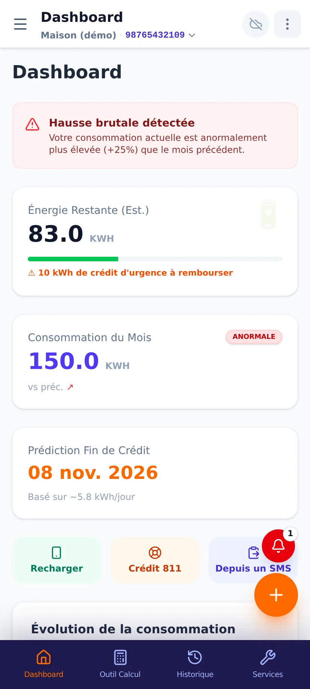<br><sub>Tableau de bord</sub></td>
    <td align="center">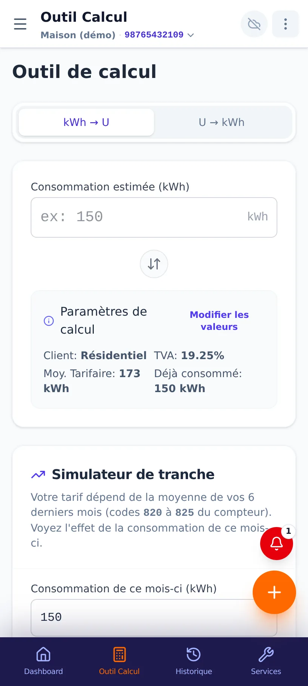<br><sub>Calcul et simulateur de tranche</sub></td>
    <td align="center">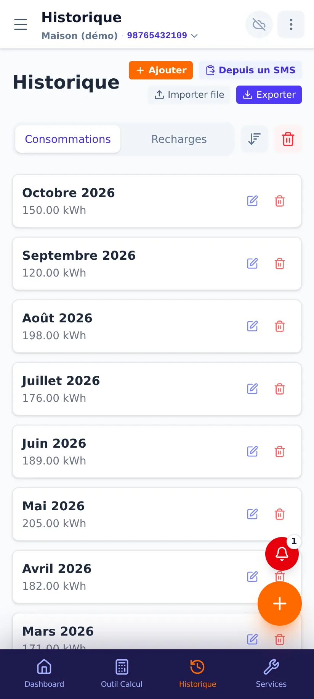<br><sub>Historique</sub></td>
  </tr>
  <tr>
    <td align="center">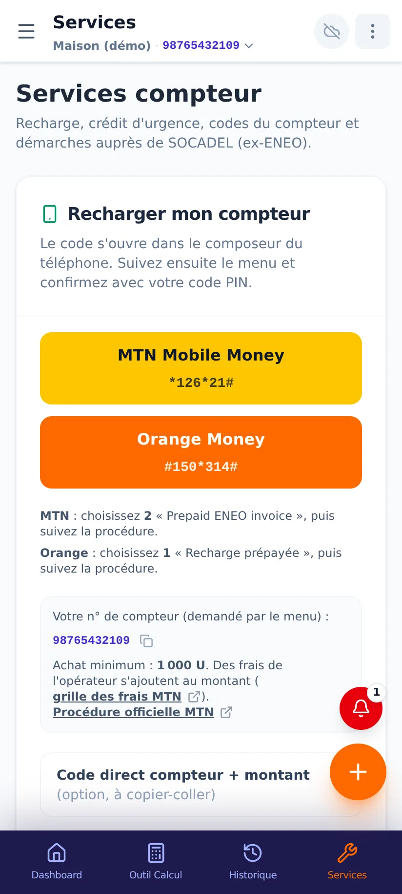<br><sub>Services : recharge par codes</sub></td>
    <td align="center">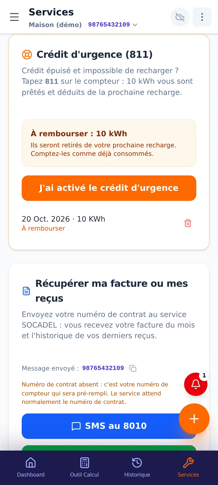<br><sub>Crédit d'urgence 811</sub></td>
    <td align="center">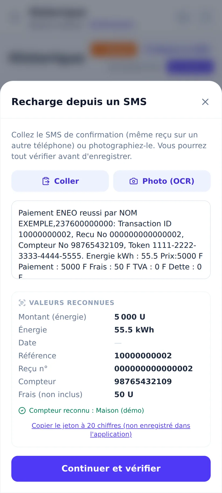<br><sub>Import depuis un SMS</sub></td>
  </tr>
  <tr>
    <td align="center">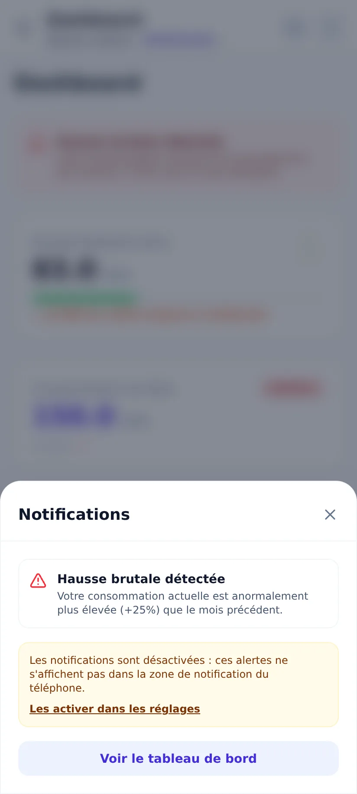<br><sub>Cloche de notifications</sub></td>
    <td align="center">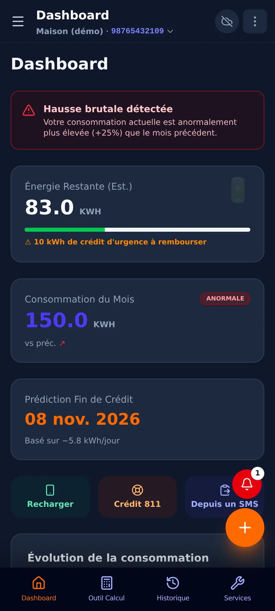<br><sub>Mode sombre</sub></td>
    <td align="center">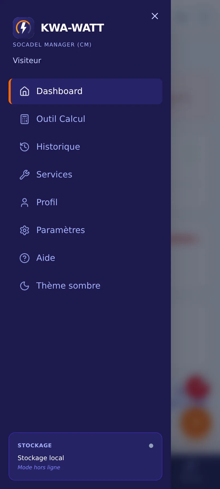<br><sub>Tiroir de navigation</sub></td>
  </tr>
  <tr>
    <td align="center">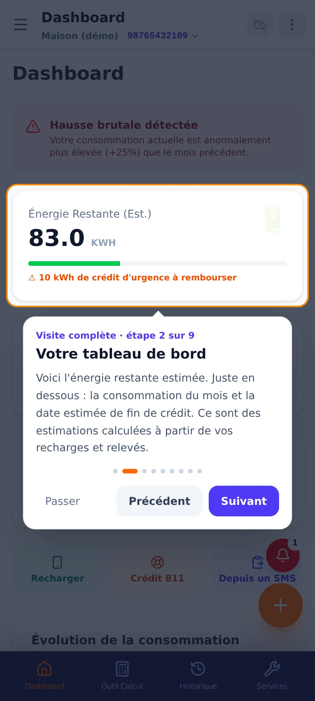<br><sub>Visite guidée</sub></td>
    <td align="center" colspan="2">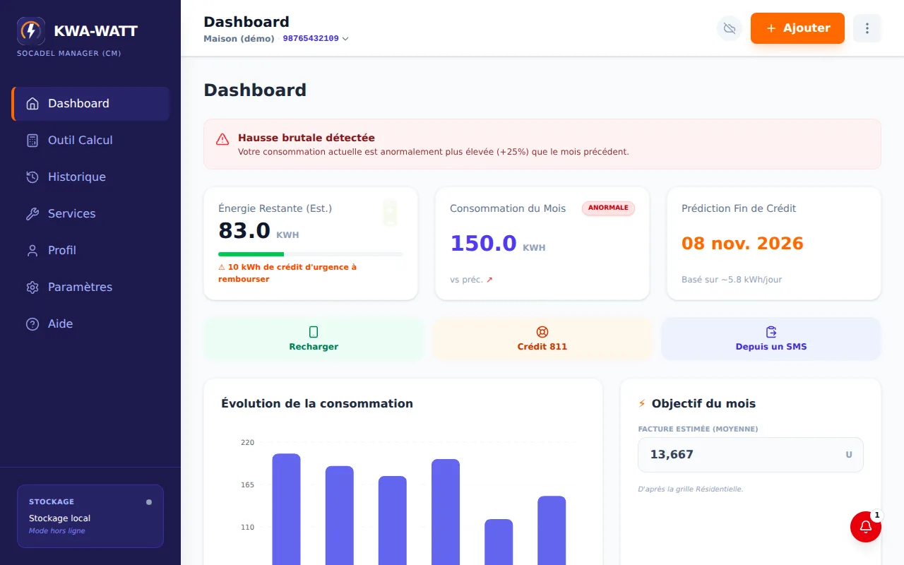<br><sub>Grand écran</sub></td>
  </tr>
</table>

## Fonctionnalités

- **Tableau de bord** : énergie restante estimée, consommation du mois, prédiction de fin de crédit, alertes.
- **Calcul** : montant ⇄ kWh selon la tranche, simulateur de tranche (moyenne des 6 derniers mois).
- **Historique** : consommations et recharges, import / export, plusieurs compteurs.
- **Services** : recharge MTN MoMo / Orange Money par codes courts USSD, crédit d'urgence 811 suivi comme une dette de kWh,
  codes du compteur (800-825, 873), diagnostic TID, demande de facture par SMS ou WhatsApp, coupures.
- **Import d'une recharge depuis un SMS** : collage ou photo (OCR Tesseract embarqué, hors ligne), contrôles du compteur et du prix au kWh.
- **Notifications** : alertes persistantes (bouton « Supprimer », republication à l'ouverture), cloche, rappels de recharge.
- **Synchronisation** : fusion par enregistrement entre appareils, photos en sous-collection ; données privées.
- **Configuration à distance** : nom de l'opérateur, liens, codes USSD modifiables sans nouvelle version.
- **Visite guidée** interactive ([détails](./docs/VISITE_GUIDEE.md)), mode sombre, tiroir mobile et barre latérale sur grand écran.

## Installation (Android)

1. Téléchargez **[kwa-watt.apk](https://github.com/OrientAbbey/kwa-watt-eneo-manager/releases/latest/download/kwa-watt.apk)**
   (dernière version publiée) ou rendez-vous sur la [page de présentation](https://orientabbey.github.io/kwa-watt-eneo-manager/).
2. Autorisez l'installation depuis cette source si Android le demande (« Sources inconnues »).
3. Facultatif mais recommandé : comparez l'empreinte **SHA-256** du fichier avec celle indiquée dans les notes de la version.

> Tant qu'aucune version n'a été publiée sur GitHub, le lien ci-dessus renvoie une erreur 404.

## Architecture

La logique métier est **pure et testée** (`src/lib`) ; les composants restent minces. Chaque schéma est une source Mermaid
versionnée dans [`docs/diagrams/`](./docs/diagrams) (rendu natif sur GitHub).

### Couches

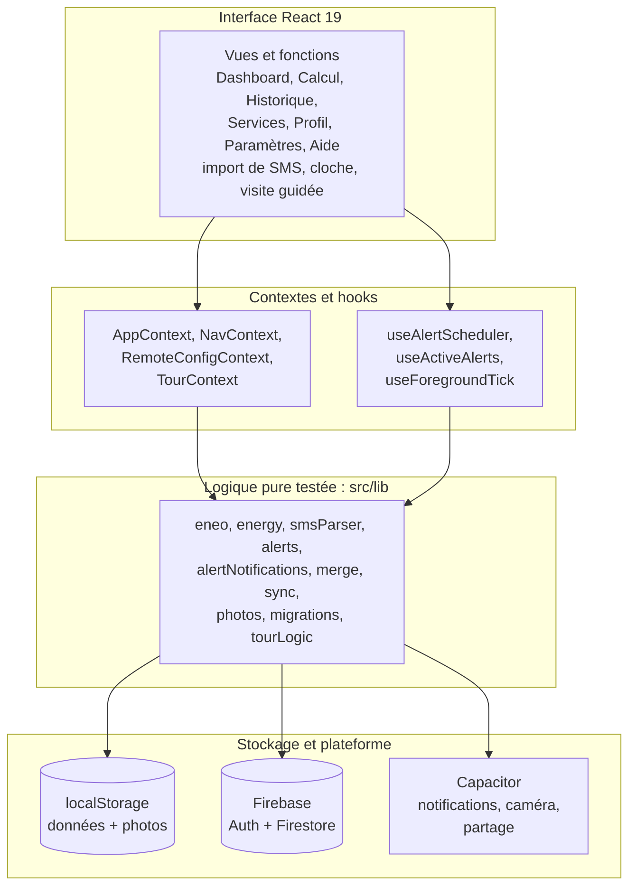

*Les vues appellent des contextes et des hooks, qui délèguent à la logique pure. Seule cette couche touche au stockage local,
à Firebase et aux plugins Capacitor.*

### Modèle de données

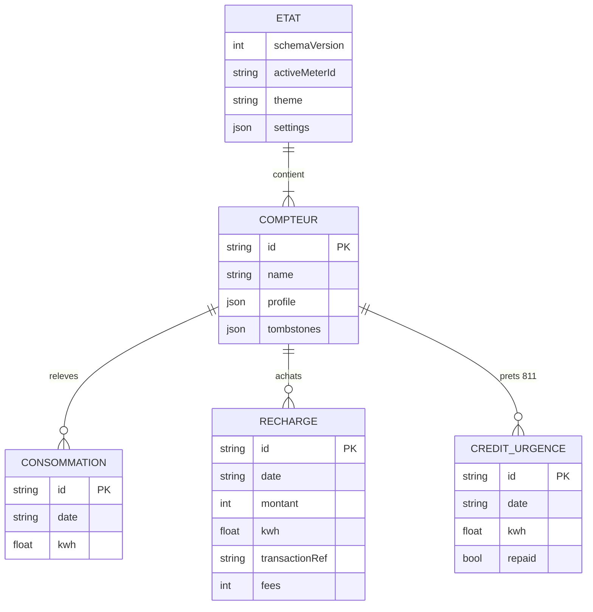

*Un état contient des compteurs ; chaque compteur porte ses relevés mensuels, ses recharges et ses crédits d'urgence. Chaque
enregistrement a un `updatedAt` (utile à la fusion). `tombstones` mémorise les suppressions pendant 90 jours ; les photos du
profil sont stockées à part. Les réglages (tarifs, alertes) sont dans `settings`. Schéma réel : `src/types.ts`.*

### Synchronisation local-first

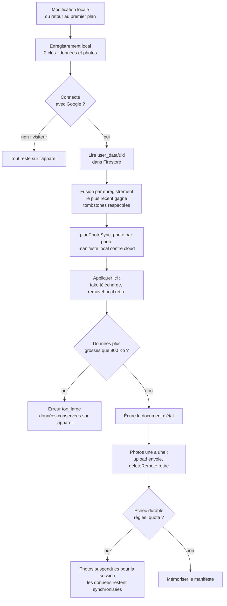

*Rien n'est envoyé en mode visiteur. Connecté, l'état est fusionné enregistrement par enregistrement (le plus récent gagne,
les suppressions ne ressuscitent pas), puis chaque photo suit un plan indépendant : un échec de photo n'empêche jamais la
synchronisation des données. Détails : [`docs/SYNC_ET_REGLES.md`](./docs/SYNC_ET_REGLES.md).*

### Import d'une recharge depuis un SMS

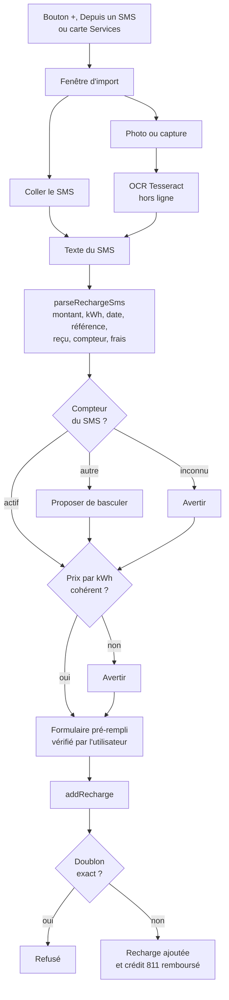

*Le jeton du compteur n'est jamais enregistré. L'utilisateur vérifie toujours le formulaire avant l'ajout ; un doublon exact
est refusé, et une recharge enregistrée rembourse automatiquement un crédit d'urgence en cours.*

### Notifications persistantes

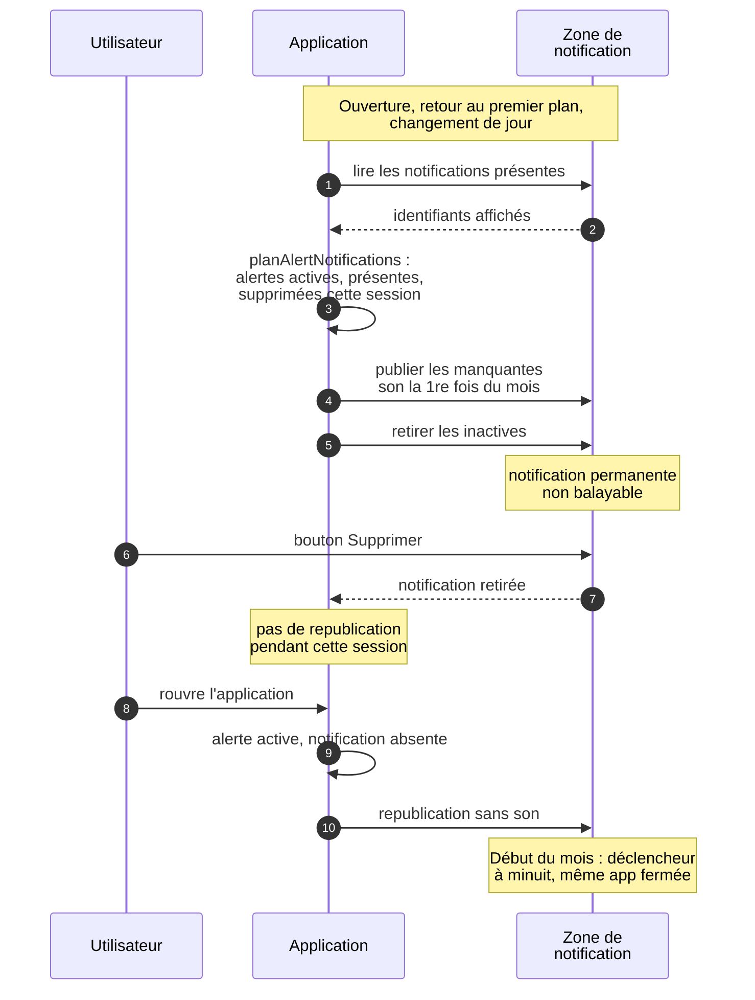

*La zone de notification reflète les alertes actives : tant qu'une alerte est active elle réapparaît à la prochaine ouverture
(sans son), et elle est retirée quand elle n'est plus active. Détails : [`docs/NOTIFICATIONS.md`](./docs/NOTIFICATIONS.md).*

### Compilation Android (CI)

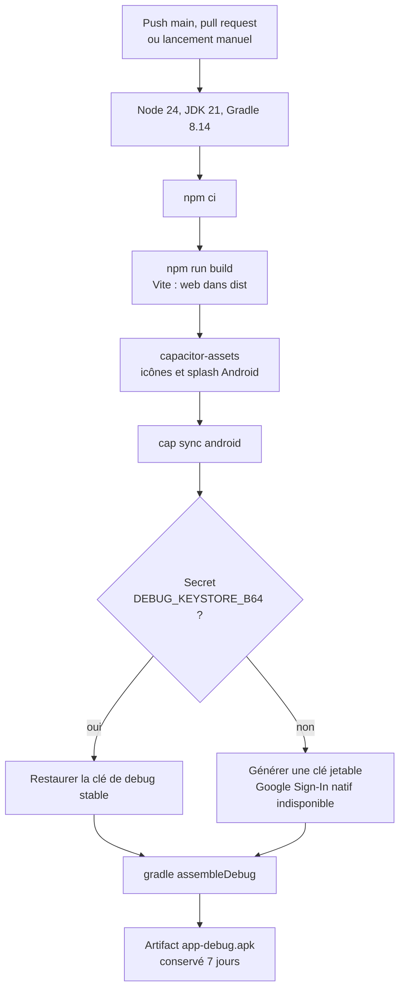

*Sans le secret `DEBUG_KEYSTORE_B64`, l'APK est quand même construit avec une clé jetable, mais la connexion Google native ne
fonctionnera pas avec lui. Voir [`docs/SIGNATURE_DEBUG.md`](./docs/SIGNATURE_DEBUG.md).*

## Démarrage développeur

Prérequis : Node.js 20+ ; JDK 21 et Android Studio uniquement pour compiler l'APK à la main.

```bash
npm install
npm run dev            # http://localhost:3000
npm run lint           # tsc --noEmit
npx vitest run         # tests (Vitest, jsdom + Testing Library pour les composants)
npm run build          # build web (dist/)
npm run cap:build      # build web + npx cap sync android, puis ouvrir android/ dans Android Studio
node scripts/bundle-size.mjs        # poids gzip du build, pour mesurer le surcoût d'une fonctionnalité
```

Outils facultatifs (n'ajoutent rien à `package.json`) :

```bash
npm i --no-save @sparticuz/chromium puppeteer-core mermaid
node scripts/screenshots.mjs        # régénère docs/screenshots  (voir docs/CAPTURES.md)
node scripts/check-diagrams.mjs     # valide les diagrammes Mermaid de docs/diagrams
```

Le CI compile un APK debug à chaque push sur `main` et à chaque pull request ; il **ne lance pas les tests** : lancez-les
avant de pousser.

## Configuration Google Sign-In (mobile — erreur « connexion (10) »)

La connexion Google sur Android repose sur le **client OAuth** (Web Client ID) et le fichier **`google-services.json`**. S'ils sont manquants, Google renvoie l'erreur développeur `10`.

📖 **La procédure complète** (projet Firebase dédié, console Google Cloud, mise à jour des identifiants, tests et dépannage) est détaillée dans **[`GOOGLE_AUTH_SETUP.md`](./GOOGLE_AUTH_SETUP.md)** — l'**état actuel** (valeurs réelles du projet `kwa-watt-eneo-manager`, apps Android/Web, Web Client ID) est dans sa **section 3.0**.

✅ **Déjà configuré** : projet dédié créé, Google Auth activé, app Android + Web enregistrées, `google-services.json` en place (`android/app/`), Web Client ID et `loginMode: 'online'` dans `src/config.ts`, règles Firestore déployées.

En bref :
1. **Console Firebase** → crée un projet dédié → active **Google Authentication** + **Firestore**.
2. Ajoute l'application **Android** (`com.eneotool.app`) avec le **SHA-1** de ta clé de signature → télécharge **`google-services.json`** → dépose-le dans `android/app/` *(exclu de git)*.
3. **Google Cloud Console** → **Écran de consentement** + **ID client OAuth type « Application Web »**.
4. Mets à jour les identifiants dans les **deux fichiers centralisés** : `src/config.ts` (`webClientId`) et `firebase-applet-config.json` (projet/sdk).
5. `npx cap sync android` + recompile.

Boilerplate technique :
- Les images d'aide officielles sont servies depuis `public/assets/help/`.
- Icône / splash : `public/icon.png` et `public/splash.png` (config `assets-config.json` pour `@capacitor/assets`).
- Toutes les constantes applicatives (client ID, scopes, délais de synchro/session, appId, hostname…) sont dans **`src/config.ts`**.

## Configuration à distance (branding, liens, tarifs)

L'app lit un document Firestore public et facultatif `app_config/branding` au démarrage (mis en cache 24h,
repli automatique sur des valeurs par défaut intégrées si absent ou hors ligne — voir `src/lib/remoteConfigSchema.ts`).
Cela permet de mettre à jour le nom de l'opérateur (ex. ENEO → SOCADEL), les liens utiles ou les codes USSD
**sans publier de nouvelle version de l'app** : `npx tsx scripts/seed-remote-config.ts` (procédure complète,
y compris récupérer une clé d'administrateur Firebase, dans [`docs/CONFIG_A_DISTANCE.md`](./docs/CONFIG_A_DISTANCE.md)).

## Index de la documentation

| Document | Contenu |
|---|---|
| [`DOCUMENTATION.md`](./DOCUMENTATION.md) | Modules et architecture, en détail |
| [`docs/USER_GUIDE.md`](./docs/USER_GUIDE.md) | Guide utilisateur |
| [`docs/VISITE_GUIDEE.md`](./docs/VISITE_GUIDEE.md) | Visite guidée : contenu, persistance, ajout d'une étape |
| [`docs/DESIGN.md`](./docs/DESIGN.md) | Document de conception |
| [`docs/SYNC_ET_REGLES.md`](./docs/SYNC_ET_REGLES.md) | Synchronisation, fusion, règles Firestore |
| [`docs/NOTIFICATIONS.md`](./docs/NOTIFICATIONS.md) | Alertes persistantes |
| [`docs/CONFIG_A_DISTANCE.md`](./docs/CONFIG_A_DISTANCE.md) | Document `app_config/branding` et script d'administration |
| [`docs/SIGNATURE_DEBUG.md`](./docs/SIGNATURE_DEBUG.md) | Clé de signature et Google Sign-In natif |
| [`GOOGLE_AUTH_SETUP.md`](./GOOGLE_AUTH_SETUP.md) | Connexion Google, de bout en bout |
| [`docs/OCR_COMPARATIF.md`](./docs/OCR_COMPARATIF.md) | Choix du moteur OCR (mesures) |
| [`docs/LOGO.md`](./docs/LOGO.md) | Logo et variantes |
| [`docs/CAPTURES.md`](./docs/CAPTURES.md) | Captures d'écran : méthode et limites |
| [`docs/QA_CHECKLIST.md`](./docs/QA_CHECKLIST.md) | Recette manuelle (web puis Android) |
| [`docs/diagrams/`](./docs/diagrams) | Sources des diagrammes Mermaid |

## Structure du projet

```text
src/
  components/    MainLayout, views/ (un fichier par onglet), features/ (cartes Services, import SMS, cloche…),
                 tour/ (visite guidée), ui/ (BottomSheet, Drawer, Card…)
  lib/           logique PURE et testée : tarifs, parseur de SMS, alertes, fusion, synchro, photos, migrations…
  store/         AppContext (état, persistance, synchro), NavContext, RemoteConfigContext
  hooks/         planificateur d'alertes, alertes actives, jour, premier plan
  config.ts      constantes centralisées (clés de stockage, client ID, délais)
android/         projet Capacitor (Gradle)
docs/            documentation, logo, captures, diagrammes
scripts/         configuration distante, assets OCR, captures, diagrammes, mesure de taille
.github/workflows/  compilation de l'APK
```

## Confidentialité

L'application fonctionne hors ligne ; en mode visiteur, vos données ne quittent pas le téléphone. Connecté avec Google, elles
sont synchronisées dans **votre** espace privé Firestore (seul votre compte peut le lire : [`firestore.rules`](./firestore.rules)).
Le code ne contient **aucune publicité ni outil de mesure d'audience**. Une réserve, par honnêteté : l'interface demande
ses polices (Inter, JetBrains Mono) à Google Fonts quand le téléphone est en ligne (`src/index.css`) ; hors ligne, une police
système est utilisée. Les SMS d'exemple du dépôt sont **fictifs**.

## Licence

[Apache License 2.0](./LICENSE). KWA-WATT est une application indépendante : voir l'avertissement en haut de ce fichier.
